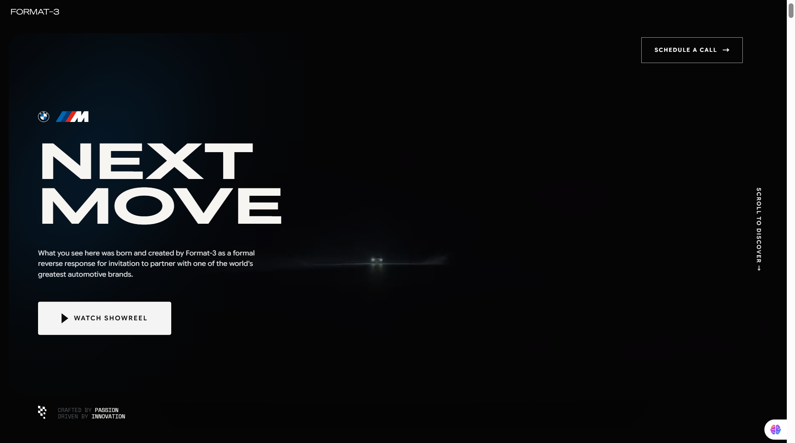
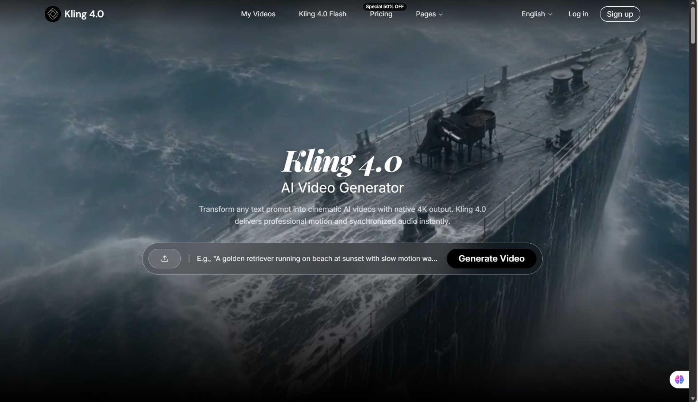
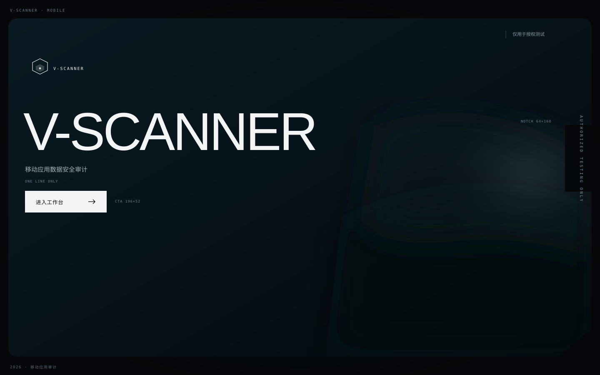
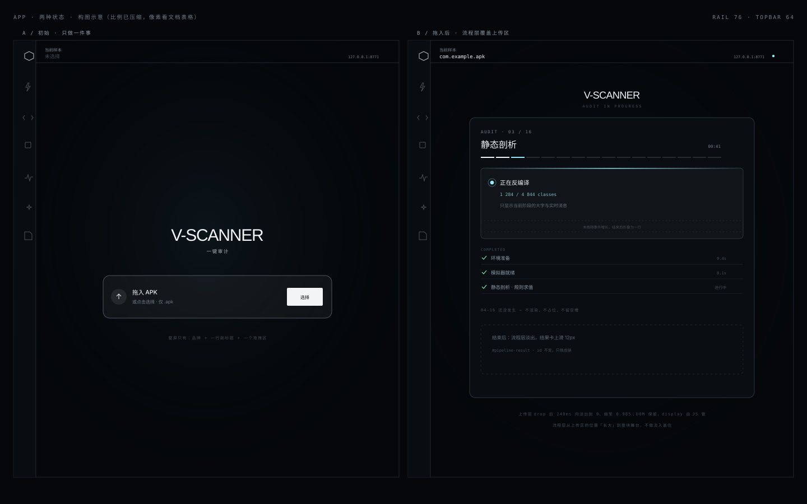
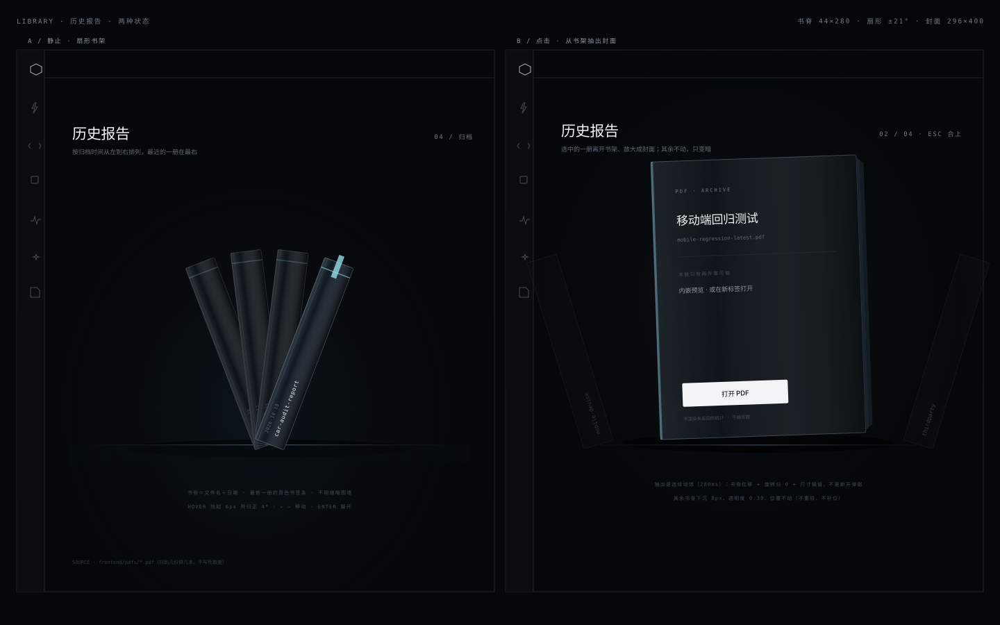

# V-Scanner 前端改版 · 开发任务书

> **项目根**：本文件所在仓库的根目录。下文所有路径都相对项目根，不含任何本机绝对路径。
> **适用对象**：接手开发的同学 / 执行 Agent。
> **版本**：2026-10-18 v3（移动端 · 暗场 · 流程覆盖 · 书本归档）
> **一句话**：首页做成一块**不规则的黑色舞台**，工作台做成**一次只演一件事**的审计台；只动 `frontend/`，一行后端代码都不许碰。

---

## 0. 接手须知

### 0.1 技术栈与边界

- 原生 **HTML + CSS + JavaScript**，**零构建**：没有 npm / webpack / vite，页面用静态服务器直接打开。
- 页面逻辑在 `frontend/app.js`（工作台）与 `frontend/landing.js`（首页），**不要**改成模块、框架或 TypeScript。
- 后端是本地 Python 流水线服务（`mobile/pipeline`），前端通过 `http://127.0.0.1:8771` 调它。
- 只改 `frontend/` 与本任务书提到的 `prompts/`、`.workbuddy/skills/`。`vehicle/`、`mobile/`、`core/`、`tools/` 一律只读。

### 0.2 目录地图

```
frontend/
├── index.html          首页
├── landing.css         首页样式
├── landing.js          首页交互（enterDashboard / enterPipeline）
├── app.html            工作台
├── app.css             工作台样式
├── app.js              工作台逻辑（对接 mobile/pipeline，唯一事实来源）
├── highlight.js        源码高亮（必须在 app.js 之前加载）
├── assets/             背景图、字体等静态资源
└── pdfs/               四份审计报告快照（不要删）
mobile/pipeline/
├── server.py           HTTP + SSE 服务（端口 8771）
├── runner.py           流水线执行器
└── stages.py           16 个阶段的定义（前端时间线的顺序来源）
apk/mobile/             可用来试拖的样本 APK
prompts/                本任务书 + 四张构图板
.workbuddy/skills/vscanner-frontend-redesign/
├── SKILL.md            项目级技能：怎么改、怎么验
├── references/         设计系统 / 契约 / 工具地图
└── scripts/            check_contract.py · shoot.py
```

### 0.3 本地启动

前置：Python 3.13（依赖见 `requirements.txt`，至少要能跑 `Pillow` / `reportlab`）；可选 Node 18+，只用于 `node --check` 语法检查。

```bash
# 1) 后端（另开终端；workdir 是产物目录，会自动创建）
python mobile/pipeline/server.py --port 8771 --workdir ./.cache/pipeline

# 2) 前端（项目根执行）
python -m http.server 8090 --directory frontend

# 3) 打开
#    http://localhost:8090/index.html
#    http://localhost:8090/app.html
```

> Windows 若 `python` 指向的不是装了依赖的解释器，用 `py -3.13` 或你的虚拟环境解释器替代。
> 没有 LLM key 时流水线走 dry-run，仍能出报告，只是标注"未生成 AI 研判"。

### 0.4 先看这两份"已过期"的文档，但不要信

- `frontend/README.md`、`frontend/CONTRACT_AUDIT.md` 记录的是 **8770 端口旧后端**（vehicle/workbench）时代的契约。
- 当前 `app.js` 已改为对接 **8771**（mobile/pipeline），两份文档**已漂移**。
- 契约以 `app.js` 与本任务书 §6 为准。

### 0.5 这一版（v3）改了什么

如果你看过上一版任务书，只看这张表就够：

| # | v2 的做法 | v3 改成 | 为什么 |
| --- | --- | --- | --- |
| 1 | 首页是一块铺满的矩形暗场 | 一块**不规则面板**：右侧挖 64×160 的凹槽，右下 45° 切角，凹槽里竖排落款 | 用户要求"不是一个完整的四边形，凹陷地方有字" |
| 2 | 底栏 `44 车载规则 / 223 移动规则 / 16 审计阶段` | **整条底栏删掉** | 字太多；数字也容易过期 |
| 3 | 正文提 AAOS / 车载 | 全部删除，只说「移动应用数据安全审计」 | **本版本只做移动端** |
| 4 | 首页正文三行、四个信息块 | **一句副标题 + 一个按钮**，别的一个字都不加 | 字要少 |
| 5 | 拖拽区 720×148 | **640×128**，内部只留两行字 | "拖入 apk 不要太大" |
| 6 | 时间线 4×4 常驻 16 格 | **拖入后覆盖上传区**，只渲染"已发生"的阶段，当前阶段一张大卡，过去的折叠成一行 | "做到哪里显示哪里" |
| 7 | 历史报告是 `<select>` 下拉 | **扇形书架**：书脊排开 → 点击抽出封面 → 打开阅读 | 用户给了参考图，要"一本书一样" |
| 8 | 字体用 Google Sans Flex | **Archivo**（可变字宽）+ Inter + JetBrains Mono | Google Sans Flex 不在 Google Fonts 公开库里，v2 的链接会 404 |
| 9 | 侧栏图标 `opacity .34` | 保持，但补了 hover/active 的"透明显影"规则 | 要"尽量透明、有高级感" |

### 0.6 产品定位（写死，不要再扩）

- **只有移动端**：Android APK 的静态 + 动态审计。不出现 AAOS、车载、车机、IVI、座舱。
- 不出现"规则库 N 条"这类会过期的数字；要展示规模就用 `16 STAGES`。
- 界面语言中文，技术标识（阶段 id、文件名、端口）用等宽英文。

---

## 1. 目标

把两个页面从现在的「深蓝紫渐变 + 玻璃卡片仪表盘」改造成
**近黑底、巨型字、发丝线、单点高光**的暗场界面：

| 页面 | 参考 | 必须做到 |
| --- | --- | --- |
| `index.html` | BMW Next Move | 不规则舞台面板；`V-SCANNER` 巨型字；副标题一行；主按钮「进入工作台」→ `app.html` |
| `app.html` | Kling 4.0 | 居中舞台；中间 `V-SCANNER`；下方小拖拽区；拖入后**流程覆盖**上传区，逐段揭示 |
| `app.html` 六个内页 | — | 同一套发丝线语法；静态/动态/源码/报告都不再是"卡片堆" |
| `app.html` PDF 页 | 书架参考图 | 四份历史报告排成**扇形书脊**，点开变**封面**，再打开阅读 |

**这不是换配色，是重做版式。** 允许改 HTML 结构，但不允许弄坏 `app.js` 与后端的契约（§6）。

三条尺度，任何一条不满足就算没做完：

1. **字要少**：首屏可见的文字块 ≤ 3 个（品牌 / 一行说明 / 一个动作）。
2. **字要大**：主标题与正文的字号比 ≥ 8:1；正文永远不超过 2 行。
3. **动效只服务"进度"**：只有"阶段推进"和"书被抽出"两处允许有编排，其余全部 ≤ 200ms 的即时反馈。

---

## 2. 构图（先看这四张，再动 CSS）

### 2.1 参考 A：BMW Next Move（首页气质）



拆解（按 16:9 画幅估算，用来理解比例，不要求像素级复刻）：

| 区域 | 位置 | 做法 |
| --- | --- | --- |
| 左上角标 | x≈3.4%，y≈2.8% | 极小字，几乎只是"署名" |
| 右上按钮 | 右边缘内收 6.5%，y≈9% | 1px 描边 + 透明底 + 全大写小字 |
| 巨型标题 | x≈4.6%，y≈32%–50% | 全大写，字高约占画幅 28%，行高 < 0.85 |
| 正文 | x≈4.6%，y≈55.5% | 3 行，宽度约 34ch，灰度 60% |
| 主 CTA | x≈4.6%，y≈68%–74.5% | 白底黑字、直角、宽约 16.8% |
| 右侧竖排 | 右边缘，垂直居中 | 10px、字距 0.28em、灰度 45% |
| 背景 | 全幅 | 近黑；唯一高光是右边一条水平光带 |

**关键不是元素，是比例**：内容块只占画幅宽度的 ~45%，右侧 55% 留给背景；标题字高是正文的 10 倍以上；整屏只有 1 个实心白块（CTA）。

### 2.2 参考 B：Kling 4.0（工作台气质）



| 区域 | 位置 | 做法 |
| --- | --- | --- |
| 顶栏 | 高约 6.5% | 透明压在背景上 |
| 标题 | 垂直约 34% | 大字品牌名，下方一行无衬线副标题 |
| 输入条 | 约 60%–67%，宽约 57% | 圆角胶囊、半透明白、1px 高光边、右侧内嵌按钮 |
| 背景 | 全幅 | 电影感实拍，低饱和冷色，暗角很重 |
| 下方内容 | 第二屏 | 营销分区、定价、FAQ——**本项目不要** |

**可借的**：居中舞台、单条输入、背景压暗、内嵌按钮的"工具感"。
**不要借的**：衬线斜体标题、营销分区、定价卡、彩色徽章、圆角胶囊（我们用 12px 圆角矩形）。

### 2.3 首页构图（1440×900，1:1）



这是一张**不规则面板**：整页铺一块近黑面板，右侧挖掉一个 64×160 的凹槽，右下角 45° 切掉 80px。凹槽里竖排一行 `AUTHORIZED TESTING ONLY`，落在页面底色（更黑）上，形成"牌匾被刻掉一块"的错觉。

锚点表（1440×900 下的像素；括号内是视口比例）：

| 锚点 | 像素 | 比例 | 说明 |
| --- | --- | --- | --- |
| 面板内缩 | 上 44 / 左右 20 / 下 44 | 4.9vh / 1.39vw | 面板之外是更黑的 `#05070A` 底 |
| 凹槽 | x 1356–1420，y 300–460 | 94.2%–98.6%，33.3%–51.1% | 深 64、高 160，硬边，无圆角 |
| 右下切角 | (1420,790) → (1340,856) | — | 45° 斜切 80px |
| 品牌行 | (78,150) 盾形 36×38 + 字 | 5.4vw / 16.7vh | 盾形 1.3px 描边，内部只留一个 2.4px 实心点 |
| 标题基线 | y=360，字号 128 | 40vh / 8.9vw | Archivo 500 / `font-stretch:112%` / 字距 −5px |
| 副标题 | (60,412) 15px | 45.8vh | 只有一句：移动应用数据安全审计 |
| CTA | (60,458) 196×52 | 4.2vw / 5.8vh | 直角、白底黑字、右箭头 16px |
| 右上授权 | 右端 1230，y=86 | 85.4vw | 11px + 左侧 1px 竖线 |
| 竖排落款 | x≈1392，rotate 90°，居中于凹槽 | 96.7vw | 9.5px / 字距 3.4px / 灰 50% |
| 页脚角标 | (24,884) | — | 9px mono，`2026 · 移动应用审计` |

**构图判据**

1. 视线是 品牌 → 巨字 → 一句副标题 → 按钮，一条**向下略偏左**的直线；
2. 标题右边缘不得越过 x=560（39%），右侧 60% 只放背景、凹槽和竖排字；
3. 整屏只有一个实心白块（CTA），其余全是 1px 线与文字；
4. 标题必须**单行**（`white-space:nowrap`），窄屏裂成 `V-` / `SCANNER` 即返工；
5. **不许**再加第五个信息块——不加规则条数、不加状态栏、不加"静态剖析/动态采集"这类术语排比。

### 2.4 工作台构图（两种状态）



左（初始）：舞台正中只有一个品牌、一行副标题、一个 640×128 的拖拽区。右（拖入后）：品牌缩到 18px，上传区消失，**流程层覆盖**原来上传区那一块，只显示"已经发生"的阶段。

| 锚点 | 规格 |
| --- | --- |
| 左侧 rail | 宽 76，hover 展开 212；覆盖内容，不挤压主区 |
| 顶栏 | 高 64；左「当前样本」，右服务地址 + 状态点 |
| 舞台 | `min-height: calc(100svh - 64px)`，内容垂直居中，宽度 `min(880px, 100% - 96px)` |
| 品牌（初始） | 56px，字距 −0.03em，居中 |
| 副标题（初始） | 距品牌 12px，13px，字距 0.18em：`一键审计` |
| 拖拽区 | 640×128，radius 12，1px `--line-2` |
| 元信息 | 距拖拽区 18px，11px mono：`16 STAGES · OBSERVE ONLY` |
| 品牌（运行） | 18px，同一位置，交叉淡入 180ms |
| 流程层 | `min(880px, 100% - 96px)`，高度 `min(560px, 100svh - 220px)` |
| 结果 | 流程结束后在舞台内上滑进入，替代流程层 |

**为什么流程要"覆盖"而不是"往下接"**：往下接会让页面在拖入瞬间长高 500px，浏览器滚动位置跳变，用户第一眼看到的是一半在上、一半在下的残局。覆盖是**同一个矩形换内容**，视线不动。

### 2.5 历史报告构图（扇形书架）



左（静止）：四本书脊立在同一块搁板上，绕底部中心分别旋转 −21° / −7° / +7° / +21°，最新的那册挂一条青色书签。右（点击）：被选中的一册离开书架、旋转归零、放大成 296×400 的封面；其余书脊下沉 8px、透明度降到 0.30，**位置不动、不补位**。

书脊尺寸：44×280，圆角 2，`1px #2A3540` 描边，左侧 1px 竖向高光，顶部 14px 处一条 1.5px 青线（最新一册透明度 0.55，其余 0.22）。

### 2.6 两页的共同语法

| 维度 | 规则 |
| --- | --- |
| 底色 | `#05070A`，不用纯黑；正文不用纯白，用 `#F2F4F6` |
| 层级 | 只用 1px 线与亮度区分，不用投影；投影只给浮层（封面、结果卡） |
| 圆角 | 只有 4 档：0（首页 CTA / 面板）/ 2（小控件、书脊）/ 12（拖拽区）/ 10（流程层） |
| 留白 | 任一屏至少有 55% 面积不放内容 |
| 彩色 | 全屏彩色像素 < 2%，只出现在状态点、书签、徽标 |
| 高光 | 每屏只有一个视觉高光（首页=右侧光带，工作台=运行中的那一格，书架=最新那册的书签） |

---

## 3. 设计系统

### 3.1 Design tokens（原样落到 `landing.css` 与 `app.css` 的 `:root`）

```css
:root {
  --bg:          #05070A;
  --bg-soft:     #080B10;
  --panel:       rgba(12, 16, 22, 0.52);
  --panel-solid: #0B0F14;
  --panel-lift:  rgba(255, 255, 255, 0.035);

  --line:   rgba(255, 255, 255, 0.09);
  --line-2: rgba(255, 255, 255, 0.16);
  --line-3: rgba(255, 255, 255, 0.30);

  --paper:   #F2F4F6;
  --paper-2: rgba(242, 244, 246, 0.66);
  --paper-3: rgba(242, 244, 246, 0.42);
  --paper-4: rgba(242, 244, 246, 0.24);

  --live: #9BE7F5;
  --pass: #7FE0AE;
  --warn: #E8C583;
  --fail: #FF8A8A;

  --font-display: "Archivo", "Inter", "PingFang SC", "Microsoft YaHei", sans-serif;
  --font-ui:      "Inter", "PingFang SC", "Microsoft YaHei", system-ui, sans-serif;
  --font-mono:    "JetBrains Mono", ui-monospace, SFMono-Regular, Menlo, monospace;

  --r-0: 0px; --r-1: 2px; --r-2: 10px; --r-3: 12px;
  --pad-x: clamp(24px, 4.6vw, 80px);
  --rail: 76px; --rail-open: 212px; --topbar: 64px;

  --ease-out: cubic-bezier(.16, 1, .3, 1);
  --ease-io:  cubic-bezier(.65, 0, .35, 1);
  --dur-1: 160ms; --dur-2: 260ms; --dur-3: 900ms;
}
```

**用色纪律**：`--live/--pass/--warn/--fail` 只用于状态点、徽标与书签，**不用于文字、按钮、边框装饰**。

### 3.2 字体

- Display 只用 **Archivo**（可变字宽，OFL 许可，Google Fonts 有）：`font-stretch: 112%; font-weight: 500; letter-spacing: -.04em`。
- UI 用 **Inter**（400/500）；数字、路径、阶段 id、端口用 **JetBrains Mono** + `font-variant-numeric: tabular-nums`。
- 中文回退 `PingFang SC / Microsoft YaHei`；**不要**再额外加载 Noto Sans SC。
- `font-stretch` 只作用于拉丁字母；中文段落不要继承拉伸（给中文容器单独写 `font-stretch: 100%`）。

`<head>` 里字体链接合并成一条（不要拆成多条 request）：

```html
<link rel="preconnect" href="https://fonts.googleapis.com">
<link rel="preconnect" href="https://fonts.gstatic.com" crossorigin>
<link href="https://fonts.googleapis.com/css2?family=Archivo:wdth,wght@62..125,100..900&family=Inter:wght@300;400;500;600&family=JetBrains+Mono:wght@300;400;500&display=swap" rel="stylesheet">
```

**字号阶梯（写死，不要临时加档）**

| 用途 | 字号 | 行高 | 字距 |
| --- | --- | --- | --- |
| 首页巨字 | `clamp(56px, 8.9vw, 132px)` | 0.86 | −.04em |
| 工作台品牌（初始） | 56 / 48（≤860px） | 1 | −.03em |
| 页面标题 | 24 | 1.25 | −.01em |
| 流程当前阶段 | 28 | 1.2 | −.01em |
| 书封面标题 | 17 | 1.35 | −.01em |
| 正文 | 13.5 | 1.7 | 0 |
| 说明 / 次要 | 11.5 | 1.6 | .01em |
| 全大写标签 | 10 | 1.4 | .18em（mono 用 .22em） |

### 3.3 布局栅格

- 12 列，`gap: 24px`，左右安全边距 `--pad-x`。
- 首页不建卡片栅格，只留三个锚点：左下内容块、右侧凹槽竖排、页脚角标。
- 工作台：`rail 76px` + 主区；主区内容最大宽度 `880px`，水平居中。
- 只用 `1px solid var(--line)` 做分隔；唯一的阴影是 `0 24px 80px rgba(0,0,0,.45)`，只给浮层（封面、结果卡）。

断点：

| 断点 | 变化 |
| --- | --- |
| `≤1180px` | 首页巨字 `8.2vw`；流程层宽度吃满舞台；书脊 40×240 |
| `≤860px` | rail 变底部 64px tab bar；隐藏右侧竖排；凹槽取消（用直边）；书架改为可横向滚动的书脊行 |
| `≤560px` | 巨字取下限 56px；拖拽区高 112px 且宽 100%；流程层 `border-radius: 0`，贴边显示 |

### 3.4 动效纪律

| 场景 | 时长 | 曲线 | 备注 |
| --- | --- | --- | --- |
| 首屏揭幕 | 900ms | `--ease-out` | 只做一次，元素 ≤ 4 组 |
| hover | 160ms | 只改 opacity / border-color / color | 不做位移与缩放 |
| 拖入 → 流程覆盖 | 260ms | `--ease-out` | 上传层淡出 + 流程层从 0.92 放大到 1 |
| 阶段推进 | 220ms | `--ease-out` | 新行入场 8px 上移淡入；**只给当前阶段** |
| 书抽出 | 280ms | `--ease-out` | 位移 + 旋转归零 + 尺寸插值，一次完成 |
| 背景漂移 | 28s | `--ease-io` alternate 无限 | 只改 transform |
| 运行脉冲 | 1.8s | 只作用于状态点/进度线 | 不作用于文字 |

- 禁止 `transition: all`；禁止全页逐元素 `fade-in-up`。
- `@media (prefers-reduced-motion: reduce)` 关闭所有 transform 动画，只保留 opacity 的瞬时切换。
- **去掉 GSAP CDN 依赖**：入场动画用 CSS；删除 `landing.js` 里 3 秒兜底计时器。

---

## 4. 背景图

### 4.1 原则

- 必须本地化到 `frontend/assets/`，**不得热链外部图片**（离线会白屏，且有版权风险）。
- 先检查 `frontend/assets/hero-bg.jpg` 是否已存在；存在就直接用，不要重复生成。
- 需要生成时，用 ImageGen（参数：`size=1536x1024`、`quality=high`）。
  **调用前必须告知会消耗约 5–10 credits 并取得同意**；拒绝则走 CSS 兜底。

### 4.2 生成提示词（英文原样使用）

```text
Ultra-minimal cinematic still for a mobile app security product, 16:9.
Near-black void (#05070A) filling most of the frame. A single thin horizontal streak of cold white light
enters from the right edge at 58% frame height, tapering into soft volumetric haze toward the center-left;
microscopic dust particles catch the light. At the extreme right, a barely legible abstract silhouette
of a phone edge and a fingerprint ridge dissolving into darkness — abstract, no brand, no model.
The left 60% of the frame is almost empty darkness, reserved for large typography.
Monochrome with a faint steel-cyan tint, 6% saturation. Anamorphic flare, fine 35mm film grain,
soft vignette, no text, no logos, no people, no highlights above 20% luminance.
Shot on 35mm, long exposure, restrained and expensive.
```

### 4.3 落盘与压缩

```bash
python -c "from PIL import Image; im=Image.open('raw.png').convert('RGB'); im=im.resize((2560,1440)); im.save('frontend/assets/hero-bg.jpg', quality=84, optimize=True, progressive=True)"
python -c "from PIL import Image; im=Image.open('frontend/assets/hero-bg.jpg'); im.resize((1280,720)).save('frontend/assets/hero-bg@1280.jpg', quality=82, optimize=True, progressive=True)"
```

要求：主图 ≤ 550KB，小图 ≤ 220KB。

### 4.4 验收图片三条硬标准

1. 左半边足够黑且干净，叠 128px 白字仍有 7:1 对比；
2. 光带最亮处不超过画面 3%，不能抢标题；
3. 缩到 320px 宽仍能看出"一束光 + 暗场"，不是一团噪点。

### 4.5 页面里的用法

```css
.bg { position: fixed; inset: 0; z-index: 0; overflow: hidden; background: var(--bg); }
.bg-image {
  position: absolute; inset: -2%;
  background: url("assets/hero-bg.jpg") center right / cover no-repeat;
  transform: scale(1.06);
  animation: bg-drift 28s var(--ease-io) infinite alternate;
  will-change: transform;
}
@keyframes bg-drift {
  from { transform: scale(1.06) translate3d(0, 0, 0); }
  to   { transform: scale(1.12) translate3d(-1.2%, -0.8%, 0); }
}
.bg-veil {
  position: absolute; inset: 0;
  background:
    linear-gradient(90deg, rgba(5,7,10,.94) 0%, rgba(5,7,10,.78) 34%, rgba(5,7,10,.30) 66%, rgba(5,7,10,.58) 100%),
    radial-gradient(120% 90% at 50% 45%, transparent 40%, rgba(5,7,10,.55) 100%),
    linear-gradient(180deg, rgba(5,7,10,.85) 0%, transparent 22%, transparent 78%, rgba(5,7,10,.92) 100%);
}
```

图片缺失时用纯 CSS 兜底：左侧纯黑 + 右侧一条 1px 冷白渐变线，保持同一构图。

---

## 5. 页面规格

### 5.1 首页 `frontend/index.html`

#### 5.1.1 不规则面板（这一版的骨头）

```css
.stage-panel {
  position: fixed; inset: 0;
  clip-path: polygon(
     3.06%  4.90%,  96.94%  4.90%,   /* 上边，左起 44px，右到 1396px */
    98.61%  7.55%,                  /* 右上小切角 */
    98.61% 33.33%,                  /* 右边下行到凹槽上沿 */
    94.17% 33.33%,                  /* 凹槽口：向内 64px */
    94.17% 51.11%,                  /* 凹槽底：向内 64px，高 160px */
    98.61% 51.11%,                  /* 出来 */
    98.61% 87.78%,                  /* 右边继续下行 */
    93.06% 95.11%,                  /* 右下 45° 切角 80px */
     3.06% 95.11%,                  /* 下边 */
     1.39% 92.44%,                  /* 左下小切角 */
     1.39%  7.55%                   /* 左边回到起点 */
  );
  background: url("assets/hero-bg.jpg") center right / cover no-repeat, var(--bg);
}
```

- **面板四角一律直角**：`clip-path` 与 `border-radius` 同时用会互相切，别试。
- 面板之外露出的 `body` 底色是更黑的 `#030507`，让"切下去"这件事看得出来。
- 凹槽与切角的缺口里**不能有内容**，否则会被裁掉。竖排字要作为面板的**兄弟节点**放：

```css
.notch-tag {
  position: fixed; right: 0; top: 33.33%; height: 17.78%; width: 64px;
  display: flex; align-items: center; justify-content: center;
  writing-mode: vertical-rl;                /* 拉丁字母会顺带旋转 90° */
  font: 500 9.5px/1 var(--font-mono);
  letter-spacing: .34em; color: var(--paper-3);
  background: #030507;                      /* 与 body 同色，看起来像刻在底上 */
  pointer-events: none;
}
```

> 凹槽宽度用 `clamp(48px, 4.4vw, 64px)`；`≤860px` 时整块凹槽取消（`clip-path` 换成不带凹槽的六边形），竖排字隐藏。

#### 5.1.2 尺寸表

| 元素 | 规格 |
| --- | --- |
| `.masthead` | `position:fixed; top:0; height:88px; padding:0 56px; display:flex; justify-content:space-between` |
| `.hero` | `min-height:100svh; padding:0 56px; display:flex; flex-direction:column; justify-content:center` |
| `.hero-mark` | 36×38 线性盾形 SVG，`opacity:.72`，距标题 40px |
| `h1` | `font:500 clamp(56px,8.9vw,132px)/.86 var(--font-display)`；`font-stretch:112%`；`letter-spacing:-.04em`；`white-space:nowrap` |
| `.lede` | 距标题 52px；15px/1.5；`color:var(--paper-2)`；**只有一行**，`max-width:none` |
| `.cta` | 距副标题 46px；`196×52`；`border-radius:0`；白底 `#F2F4F6` + 字 `#06080B`；12.5px/500；字距 `.08em`；右侧箭头 16px |
| `.cta:hover` | 背景变透明，1px `--line-3` 边框（默认带 `border:1px solid transparent`，避免抖动），箭头 `translateX(4px)`，200ms |
| `.corner-note` | `position:fixed; left:24px; bottom:16px`；9px mono；`--paper-4` |
| `.authorized` | 右上，11px `--paper-3`，左侧 `1px solid var(--line-2)` 竖线，`padding-left:14px` |

#### 5.1.3 文案（照抄，一个字都不要加）

- 左上品牌：`V-SCANNER`（mono 10px，字距 .22em）
- 右上：`仅用于授权测试`
- 主标题：`V-SCANNER`
- 副标题：`移动应用数据安全审计`
- 按钮：`进入工作台`
- 凹槽竖排：`AUTHORIZED TESTING ONLY`
- 左下角标：`2026 · 移动应用审计`

> 不要加：规则条数、阶段数、"静态剖析/动态采集"排比句、AAOS、车载、KPI、状态栏。

#### 5.1.4 入场动效（纯 CSS，只做一次编排）

1. `h1` 外层 `overflow:hidden`，内层 `translateY(108%) → 0`，900ms，延迟 100ms；
2. `.lede` `opacity 0→1` + `translateY(12px→0)`，700ms，延迟 320ms；
3. `.cta` 同上，520ms，延迟 460ms；
4. 角标/竖排只做 `opacity`，800ms，延迟 640ms。

保留全局函数 `enterDashboard()`（跳 `app.html`）与 `enterPipeline()`（跳 `app.html#pipeline`）。

### 5.2 工作台 · 初始态

结构（**id 一个都不能少**，只加新壳）：

```html
<section class="page active" id="page-pipeline">
  <div class="stage" id="audit-stage" data-state="idle">
    <header class="stage-brand">
      <div class="brand-lg">V-SCANNER</div>
      <div class="brand-sub">一键审计</div>
      <div class="brand-sm">V-SCANNER</div>
      <div class="brand-sm-sub">AUDIT IN PROGRESS</div>
    </header>

    <div class="stage-slot">
      <div class="pipeline-dropzone" id="pipeline-dropzone"> … 原样保留 … </div>
      <div class="pipeline-progress" id="pipeline-progress" style="display:none">
        <div class="pipeline-job" id="pipeline-job"></div>
        <div class="stage-rail" data-rail aria-hidden="true">
          <i style="--i:0"></i> … 共 16 个 …
        </div>
        <ol class="pipeline-timeline" id="pipeline-timeline"></ol>
      </div>
    </div>

    <div class="pipeline-result" id="pipeline-result" style="display:none"></div>
  </div>
</section>
```

| 元素 | 规格 |
| --- | --- |
| `.stage` | `min-height:calc(100svh - var(--topbar)); display:flex; flex-direction:column; align-items:center; justify-content:center; gap:0` |
| `.stage-brand` | 高 96px（初始）→ 56px（运行）；内部两套品牌做交叉淡入，**不要**用 `font-size` 过渡（会抖） |
| `.brand-lg` | 56px，Archivo 500，字距 −.03em |
| `.brand-sub` | 距品牌 12px，13px，字距 .18em，`--paper-2` |
| `.brand-sm` / `.brand-sm-sub` | 18px / 9px mono 字距 .28em；初始 `opacity:0` |
| `.stage-slot` | `position:relative; width:min(880px,100%); min-height:min(560px, calc(100svh - 240px)); display:flex; align-items:center; justify-content:center`（**高度恒等于流程层**，拖入时页面不重排） |
| 拖拽区 | `640×128`（在 slot 里居中），radius 12，`1px solid var(--line-2)`，`rgba(255,255,255,.045)`，`backdrop-filter:blur(14px)`；`[data-state=running]` 时 `opacity:0; transform:scale(.985); pointer-events:none` |
| 拖拽区内部 | 左 40px 圆（`.08` 白）内 16px `upload` 图标；主文 `拖入 APK`（15px/500）；副文 `或点击选择 · 仅 .apk`（11.5px `--paper-3`）；右侧 `选择` 按钮 34px 高 |
| hover | 边框 `--line-3`，背景 `.065`，180ms |
| `.dragover` | 边框 `rgba(255,255,255,.55)`，背景 `.09`，`scale(1.004)`，外发光 `0 0 0 1px rgba(255,255,255,.15), 0 20px 80px rgba(120,200,255,.08)` |
| 元信息 | 距拖拽区 18px，11px mono `--paper-3` 字距 .14em：`16 STAGES · OBSERVE ONLY` |

**文案瘦身（这一条是硬要求）**：现在 `.pipeline-dz-title` 是"拖入 APK，一键全流程审计"、`.pipeline-dz-sub` 是一长串"静态剖析 → 模拟器动态采集（Frida 插桩 / 流量镜像）→ 关联分析 → AI 研判 → 报告"，**全部换掉**：

- 标题 → `拖入 APK`
- 副文 → `或点击选择 · 仅 .apk`

不许在拖拽区里解释流程。流程自己会演。

### 5.3 工作台 · 审计流程（覆盖 + 逐段揭示）

这是本版最重要的一段，做不对整页就废。

#### 5.3.1 状态机

`.stage[data-state]` 三个值，由 §6.4 的补丁维护：

| 值 | 触发 | 表现 |
| --- | --- | --- |
| `idle` | 初始 / 重置 | 拖拽区可见；流程层被 JS 的 `display:none` 藏住 |
| `running` | `#pipeline-progress` 从隐藏变可见 | 拖拽区 `opacity:0; transform:scale(.985); pointer-events:none`；流程层 `scale(.92)→1`、`opacity 0→1`；品牌缩成 18px |
| `done` | `#pipeline-result` 出现 | 流程层 `opacity:0`（200ms）后整块 `visibility:hidden`；结果卡 `translateY(12px)→0` |

**不要**在 `done` 时清空 `#pipeline-timeline`——那是 `app.js` 的地盘。用 `opacity` 让它退场即可。

#### 5.3.2 "做到哪里显示哪里"

`app.js` 每次事件都会把 `#pipeline-timeline` 整个重建（`host.textContent=''` 后逐条 append），
每条 `<li>` 的类名是 `pl-pending / pl-running / pl-done / pl-failed / pl-skipped`（**不是** `.pipeline-card`，`.pipeline-card` 只用于结果卡）。所以：

```css
/* 未来阶段：不渲染 */
#pipeline-timeline > .pl-pending { display: none; }

/* 已完成的：折叠成一行 */
#pipeline-timeline > .pl-done,
#pipeline-timeline > .pl-skipped {
  display: grid; grid-template-columns: 16px 1fr auto; align-items: center;
  gap: 10px; height: 34px; padding: 0 2px;
  border-bottom: 1px solid rgba(255,255,255,.05);
  font-size: 12.5px; color: var(--paper-3);
}
#pipeline-timeline > .pl-done .pl-dot { width: 5px; height: 5px; background: var(--pass); }
#pipeline-timeline > .pl-done .pl-msg { display: none; }        /* 过去的消息不占地方 */
#pipeline-timeline > .pl-done[data-cost] .pl-label::after {   /* 没拿到耗时就不渲染 */
  content: "· " attr(data-cost); margin-left: 10px;
  font: 400 10px var(--font-mono); color: var(--paper-4);
}

/* 当前阶段：唯一一张"卡" */
#pipeline-timeline > .pl-running {
  position: relative;                     /* ::before 的高光线以它为定位基准 */
  display: block; margin: 14px 0 10px; padding: 22px 24px 24px;
  border: 1px solid var(--line-2); border-radius: 10px;
  background: rgba(255,255,255,.03);
  animation: stage-in 220ms var(--ease-out) both;
}
#pipeline-timeline > .pl-running .pl-label { font-size: 28px; line-height: 1.2; color: var(--paper); }
#pipeline-timeline > .pl-running .pl-msg   { margin-top: 10px; font: 400 12px/1.6 var(--font-mono); color: #7FB9C4; }
#pipeline-timeline > .pl-running::before {                     /* 顶部一条流动的高光 */
  content: ""; position: absolute; left: 0; right: 0; top: 0; height: 1px;
  background: linear-gradient(90deg, transparent, var(--live), transparent);
  background-size: 40% 100%; animation: scan 1.8s linear infinite;
}
@keyframes stage-in { from { opacity: 0; transform: translateY(8px); } to { opacity: 1; transform: none; } }
@keyframes scan     { from { background-position: -40% 0; } to { background-position: 140% 0; } }
```

- `.pl-failed` 用 `--fail` 的点 + 一段 1 行错误信息，其余同 `.pl-done`。
- 因为 DOM 每次重建，**只能给 `.pl-running` 加 entry 动画**；给 `.pl-done` 加动画会导致所有历史行每 300ms 集体闪一次。

#### 5.3.3 流程层的壳

| 部件 | 规格 |
| --- | --- |
| 外框 | `position:absolute; inset:0; padding:22px 24px 20px; border:1px solid var(--line-2); border-radius:10px; background:rgba(8,11,16,.86); backdrop-filter:blur(20px)` |
| 头部 | 左：`AUDIT · 03 / 16`（11px mono，字距 .18em，`--paper-3`）；右：计时 `00:41`（11px mono） |
| 阶段名 | 28px，与头部间距 14px |
| 进度轨 | 16 段 3px 横条，`gap:5px`；已完成 `--paper`，当前 `--live`，未发生 `rgba(255,255,255,.12)` |
| 列表滚动 | `max-height: calc(100% - 132px); overflow-y:auto; scrollbar-width:thin;` 底部 `mask-image: linear-gradient(180deg,#000 88%,transparent)` |
| 结果位 | 结果卡不放流程层里，放 `.stage-slot` 之后，正常文档流 |

**进度轨怎么在纯 CSS 下动**（避免为了 16 个点写 JS）：在 `app.html` 里静态写 16 个 `<i>`：

```html
<div class="stage-rail" data-rail aria-hidden="true">
  <i style="--i:0"></i> … 共 16 个 …
</div>
```

```css
.stage-rail { display:flex; gap:5px; }
.stage-rail i {
  flex:1; height:3px; background: rgba(255,255,255,.12);
  opacity: clamp(.12, calc((var(--p, 0) - var(--i)) * 6), 1);
  transition: opacity 200ms linear;
}
```
补丁只负责把"已发生阶段数"写进 `--p`（见 §6.4）。**不要**用 CSS 去数 16 个 `<li>`，数不出来。

#### 5.3.4 时长

`app.js` 的 SSE 事件里带 `ts`；补丁在把 `--p` 写进去的同时，可以把上一条 `.pl-done` 的 `data-cost` 填成 `8.1s`。
**拿不到就留空**——不要在前端自己算一个假的耗时。

### 5.4 历史报告 · 扇形书架（`#page-pdf-report`）

#### 5.4.1 三个状态

`#page-pdf-report[data-state]`：

| 值 | 画面 | 交互 |
| --- | --- | --- |
| `browse` | 四本书脊立在搁板上（§2.5 左图） | hover 抬起 6px 且归正 4°；`←/→` 在书脊间移动焦点；`Enter` 进入 `open` |
| `open` | 选中的一册抽出、放大成 296×400 封面，其余变暗（§2.5 右图） | `Esc` 回 `browse`；「打开 PDF」进入 `reading` |
| `reading` | 封面淡出，`#pdf-viewer-container` 占满舞台，左上角「← 返回书架」 | 返回即回 `open` |

#### 5.4.2 数据从哪来（不许编）

书架**不新建数据源**，只读现有的 `#pdf-select`：

```html
<select id="pdf-select">   <!-- 保持原样，用 .sr-only 藏起来 -->
  <option value="">选择报告...</option>
  <option value="pdfs/mobile-device-latest.pdf">移动端设备审计（最新）</option>
  ...
</select>
```

- 补丁遍历 `#pdf-select option`（跳过 `value=""`），一本生成一个 `<button class="shelf-book">`；
- 点击 = `sel.value = opt.value; sel.dispatchEvent(new Event('change', {bubbles:true}))`，之后完全交给现有的 `loadPdf()`；
- **删掉 `car-audit-report.pdf` 那条 option**（文件留在 `pdfs/` 不动）。本产品只做移动端，界面不该出现车载报告。
- 封面只允许写：报告名（option 文本）、文件名（value 的 basename）、两个动作。**不许**渲染风险数、页数、通过率——这些接口没返回，写了就是造假。

#### 5.4.3 几何

| 部件 | 规格 |
| --- | --- |
| 搁板 | 1.5px 渐变线（两端透明），宽 = 书架宽，下方 24px 深色带做"投影面" |
| 书脊 | 44×280，`transform-origin: 50% 100%`，角度 `−21° / −7° / +7° / +21°`，`translateY(-2px)` 起始 |
| 书脊文字 | `writing-mode: vertical-rl`，mono 8px `--paper-3`；文件名在右、日期在左（各 14px 内边缩进） |
| 书签 | 最新一册：顶部一条 8×34 的 `--live` 竖条，`opacity:.75` |
| 封面 | 296×400，radius 3，`1px #3A4753`，左侧 3px `--live` 竖条，内页厚度用两条 5px 斜切 |
| 书脊数量 | 有几份 PDF 就几本；超过 7 本时改成横向滚动，**不要**缩到 30px 以下 |

#### 5.4.4 动效

```css
.shelf-book { transition: transform 280ms var(--ease-out), opacity 280ms var(--ease-out); }
.shelf-book:hover,
.shelf-book:focus-visible { transform: rotate(0deg) translateY(-6px); }

[data-state="open"] .shelf-book:not(.is-active) { transform: translateY(8px) scale(.98); opacity: .30; }
[data-state="open"] .shelf-book.is-active { transform: rotate(0deg) translateY(-40px) scale(6.7); z-index: 5; }
```

> `scale(6.7)` 是"书脊→封面"的近似插值（44×280 → 296×400 不是等比，实际用
> `transform: matrix()` 或直接给两套节点做交叉淡入，二选一）。**关键要求是"连续"，不是"弹窗"**：
> 不允许 `display:none` 硬切，不允许 `position:fixed` 的 modal 遮罩。

### 5.5 其余五个内页（保持功能，只统一皮肤）

统一骨架，**不要再出现"卡片套卡片"**：

```html
<header class="page-head">
  <h2>静态审计</h2>
  <div class="page-meta"><span class="mono">com.example.apk</span><span>128 findings</span></div>
</header>
```

| 规则 | 值 |
| --- | --- |
| `.page-head` | 高 72，底部 1px `--line`；标题 24px；右侧 meta 11px mono `--paper-3` |
| 内容区 | `max-width:1080px; margin:0 auto; padding:40px var(--pad-x) 64px` |
| 卡片 | **全部拆掉**；用 1px 行线 + 8px 行距分区 |

逐页：

- `#page-source`：`grid-template-columns: 300px 1fr`，中间 1px 竖线；文件树行高 30，hover `.04` 白，active 左侧 2px 白条 + 文字转 `--paper`；代码区 `#07090C`，`.code-content` 12.5px/1.75 mono，行号列 `--paper-4`。
- `#page-static` / `#page-dynamic`：表格**无斑马纹**；行线 1px `--line`；表头 10.5px 全大写 `--paper-3` 字距 `.12em`；单元格 12.5px，padding `12px 14px`；首列用 mono。
- 徽标（`.result-badge` / `.info` / `.warning` / `.critical`）：透明底 + 1px 同色边框 + 同色字，10.5px，radius 2；**不要实心胶囊**。
- `#page-ai-report`：正文 `max-width:74ch`，14px/1.8；`.report-section-title` 12px 全大写 `--paper-3` 字距 `.14em`，section 之间只一条发丝线。
- `#page-pdf-report`：见 §5.4；`#pdf-viewer-container` 在 `reading` 态下 `height: calc(100svh - var(--topbar) - 72px)`，iframe 1px 边框 radius 8。

工作台背景：复用 `hero-bg.jpg`，`filter: brightness(.42) saturate(.85) blur(1.5px)`，再叠
`radial-gradient(90% 70% at 50% 30%, transparent, rgba(5,7,10,.72))`。

### 5.6 响应式要点

- `≤860px`：rail 变底部 64px tab bar（6 个图标等分，文字隐藏）；舞台 `min-height: calc(100svh - 56px - 64px)`；拖拽区宽 100%。
- `≤560px`：流程层贴边（radius 0），`.pl-running .pl-label` 降到 22px；书架改为横向滚动（书脊 40×240，角度全部归零，`scroll-snap-type: x mandatory`）。
- 任何断点下都**不能**出现横向滚动条。

---

## 6. 不能破坏的契约（逐条核对）

### 6.1 `app.js` 硬取的 17 个 id

```
ai-report  apk-switch  code-view  current-apk-name  dynamic-results
file-tree  pdf-open-external  pdf-select  pdf-viewer-container
pipeline-apk-input  pipeline-dropzone  pipeline-job  pipeline-progress
pipeline-result  pipeline-timeline  source-filter  static-results
```

页面容器：`#page-pipeline #page-source #page-static #page-dynamic #page-ai-report #page-pdf-report`，
切换靠 `.nav-item.active` 与 `.page.active`。CSS 必须有：

```css
.page { display: none; }
.page.active { display: block; }
```

> `#page-source.active` 若需要 `grid`、`#page-pdf-report.active` 若需要 `flex`，
> 在各自选择器里覆盖 `display`，不要改全局规则。

### 6.2 动态生成、CSS 必须覆盖的类名

```
.pipeline-card .pl-dot .pl-label .pl-msg .pl-kv .pl-links .pl-btn .pl-btn.primary
.pl-warn .pl-status .pl-pending .pl-running .pl-done .pl-failed .pl-skipped
.result-badge .s-good .s-warning .s-muted .s-critical .info .warning .critical
.empty-state .empty-state.large .notice .notice.bad .notice.ok
.file-tree-item .file-tree-item.active .ft-icon .ft-name .ft-children
.code-meta .code-content .results-table .mono .hint .static-summary
.report-section .report-section-title .report-content .perm-list .perm-chip
.pdf-frame .has-frame
```

### 6.3 其他必须保留的行为

- `#pipeline-apk-input`：`<input type="file" accept=".apk" hidden>`，点击拖拽区触发它。
- `#pipeline-progress` / `#pipeline-result` 初始 `style="display:none"`；显隐由 JS 行内样式控制，
  **CSS 不要给这两个 id 写 `display`**（会与 `style.display=''` 打架）。要给形状就用
  `position / padding / border / background`，别碰 `display`。
- `#pdf-open-external` 内必须有一个 `<a>`（`loadPdf()` 会 `querySelector('a')`）。
- `#pdf-select` 必须保留为 `<select>` 且选项来自 HTML，**不要**改成自定义组件。
- `highlight.js` 必须在 `app.js` 之前加载（`window.VSCAN_HL.render`）。
- `#source-filter` 必须是 `<input type="search">`。
- 源码渲染零 `innerHTML`，继续走 `textContent` / `VSCAN_HL`。
- API：`http://127.0.0.1:8771` + `/api/stages`、`POST /api/pipeline?name=`、
  `/events`（SSE，结束发 `event: end`）、`/static`、`/tree`、`/source?path=`、`/report`、`/bundle`。
- 16 个阶段 id 顺序不变：`prepare boot static frida_server network install launch conn_probe
  mitm hooks explore death_probe correlate bundle ai_review report`。

### 6.4 `app.js` 允许的改动（白名单，≤ 70 行）

只允许**在文件末尾追加一段自包含的补丁**，不改任何现成函数体、不改请求逻辑、不改 SSE 解析、不改 `state` 结构、不改 `PIPELINE_API_BASE`。

补丁只做四件事，每件都必须带存在性判断：

```js
/* 1) 舞台状态：idle / running / done —— MutationObserver 监听两个容器的 style 属性 */
/* 2) 进度轨：把已发生阶段数写进 .stage-rail 的 --p */
/* 3) 流程列表：每次重建后 scrollTop = scrollHeight（做到哪跟到哪） */
/* 4) 书架：把 #pdf-select 的 option 渲染成 .shelf-book，点击回写 select 并 dispatch change */
```

参考实现（可照抄，注意不要动其它函数）：

```js
(function () {
  var stage = document.getElementById('audit-stage');
  var prog  = document.getElementById('pipeline-progress');
  var res   = document.getElementById('pipeline-result');
  var rail  = document.querySelector('[data-rail]');
  var list  = document.getElementById('pipeline-timeline');

  function sync() {
    if (stage && prog && res) {
      var running = prog.style.display !== 'none';
      var done = res.style.display !== 'none' && res.children.length > 0;
      stage.dataset.state = done ? 'done' : (running ? 'running' : 'idle');
    }
    if (rail && list) {
      var n = list.querySelectorAll('.pl-done, .pl-failed, .pl-skipped').length;
      rail.style.setProperty('--p', n);
    }
    if (list) list.scrollTop = list.scrollHeight;
  }

  if (prog && res && window.MutationObserver) {
    var mo = new MutationObserver(sync);
    mo.observe(prog, { attributes: true, attributeFilter: ['style'], childList: true, subtree: true });
    mo.observe(res,  { attributes: true, attributeFilter: ['style'], childList: true });
  }
  sync();

  function buildShelf() { /* 读 #pdf-select → 生成 .shelf-book；点击回写 value + dispatch change */ }
  var page = document.getElementById('page-pdf-report');
  if (page) { buildShelf(); page.dataset.state = 'browse'; }
})();
```

**禁止**在补丁里做的事：`setInterval` 轮询、改写 `renderPipelineTimeline`、给 `<li>` 加额外 class、把 `#pipeline-timeline` 的内容搬到别处、把 `select` 换成自绘。

---

## 7. Skills / MCP 使用手册

项目级技能在本仓库内：`.workbuddy/skills/vscanner-frontend-redesign/`。
开工先读它的 `SKILL.md`，再按下面用外部技能。

### 7.1 必用

**① `frontend-design` —— 设计定调 + 自评**

- 路径：`skills/anthropics-skills/skills/frontend-design/SKILL.md`
- 时机：写 CSS 前读一次；截图验收时再读一次。
- 怎么用：读全文 → 按它的 `color / type / layout / principles` 四段式核对 §3 → 用它列出的
  "AI 味"清单逐条自查，命中即返工。
- 不要用它的示例配色（米色 + 陶土色），那是它自己点名的 AI 味。

**② `webapp-testing` —— 截图与功能回归**

- 路径：`skills/anthropics-skills/skills/webapp-testing/`
- 前置（若未安装 playwright）：

  ```bash
  python -m pip install playwright
  python -m playwright install chromium
  ```

- 怎么用：本项目已提供更贴合的快照脚本，优先跑：

  ```bash
  python .workbuddy/skills/vscanner-frontend-redesign/scripts/shoot.py --nav
  ```

  输出在 `output/frontend-shots/`：index/app × 1440×900 / 390×844，外加 6 个功能页。
- 判定：文字溢出、元素重叠、首屏出现滚动条、书脊互相穿插 = 返工。

**③ `lucide` —— 图标几何**

- 路径：`skills/lucide/icons/`（ISC 许可，可商用）
- 只取 9 个：`zap code-xml scan-search activity sparkles file-text upload shield-check arrow-right`
- 处理：保留 `viewBox` 与 `path`，删 `width/height/class`，统一 `stroke-width:1.25`、`currentColor`、`fill:none`。
- 不要引包、不要 CDN、不要 emoji。

### 7.2 MCP

**Playwright MCP（首选）**

配置在用户主目录的 `.workbuddy/mcp.json`（Windows：`%USERPROFILE%\.workbuddy\mcp.json`；
macOS/Linux：`~/.workbuddy/mcp.json`）。把下面这段**合并**进已有的 `mcpServers`，不要覆盖其它项：

```json
{
  "mcpServers": {
    "playwright": {
      "command": "npx",
      "args": ["@playwright/mcp@latest", "--viewport-size=1440,900"]
    }
  }
}
```

启用需要人工点一次：保存 → 打开「连接器管理 → 自定义连接器」→ 对 `playwright` 点「信任」→ 重开会话。

调用序列：

```
browser_navigate  http://localhost:8090/index.html
browser_take_screenshot                     # 核对不规则面板、凹槽、切角
browser_resize    390x844 → browser_take_screenshot
browser_navigate  http://localhost:8090/app.html
browser_console_messages                    # 只看 error
browser_file_upload  apk/mobile/*.apk       # 关键：验证"覆盖 + 逐段揭示"
browser_take_screenshot                     # 运行中：只有当前阶段是卡
browser_click     .nav-item[data-page="pdf-report"]
browser_take_screenshot                     # 书架：书脊扇形
browser_click     .shelf-book:nth-child(2)
browser_take_screenshot                     # 抽出：封面
```

**Chrome DevTools MCP（条件启用）**

只在首屏卡顿或 console 报错定位不到时开：

```json
{"mcpServers":{"chrome-devtools":{"command":"npx","args":["-y","chrome-devtools-mcp@latest","--no-usage-statistics"]}}}
```

调用：`navigate_page → performance_start_trace(reload=true) → performance_stop_trace`；
`list_console_messages` / `get_network_request`。
判定：LCP < 1.8s（本地），无 > 200ms 的 long task。

**降级链**：MCP `playwright` → 内置 `playwright-cli` / `agent-browser` →
`python -m playwright` → 人工截图（并在交付里写明"未做自动化验收"）。

### 7.3 明确禁用

| 资源 | 原因 |
| --- | --- |
| `theme-factory` / `brand-guidelines` | 会覆盖定制色板、带入 Anthropic 品牌 |
| `canvas-design` / `web-artifacts-builder` | 产物是海报 / React 制品 |
| `shadcn-ui` / `shadcn-ui-mcp-server` / `magic-mcp` | React 组件，与零构建冲突 |
| `daisyui` / `tailwindcss` / `unocss` | 需要构建步骤 |
| `motion` / `motion-primitives` / `magicui` / `react-bits` / `react-spring` / `auto-animate` / `sonner` / `vaul` | 全部 React 运行时 |
| `vuejs-skills` / `antfu-skills` | Vue/Vite 生态 |
| `motionsites-ai` | 空目录，无内容 |

> `animejs` 默认也不用；CSS 确实做不出时才 vendor `dist/bundles/anime.umd.min.js` 到
> `frontend/vendor/`，禁 CDN。

---

## 8. 执行顺序（每步自检后再下一步）

1. **基线**：读技能 + 跑 `check_contract.py`，把输出贴进工作记录。
2. **背景图**：确认/生成 `hero-bg.jpg`，压到体积上限内，用 Pillow 输出小图。
3. **首页**：先落 `clip-path` 面板与凹槽（这一步截图确认形状对了），再排字，最后加动效；`node --check frontend/landing.js`。
4. **工作台骨架**：rail + topbar + `.stage` 三态容器（保留全部 id）。
5. **工作台初始态**：品牌 + 640×128 拖拽区 + 元信息。
6. **流程覆盖**：先做 `data-state` 切换 + 拖拽区淡出，再做 `.pl-pending{display:none}` 与 `.pl-running` 大卡，最后接 §6.4 补丁。
7. **书架**：先排静态书脊（角度/书签），再做抽出、再做阅读态。
8. **内页皮肤**：源码 / 静态 / 动态 / AI 报告四页统一 `page-head` + 无卡片化。
9. **验收**：`check_contract.py` → `node --check` → `shoot.py --nav` → 手工走完整流程。
10. **回报**：按 §11 输出。

不要一次性生成四个文件然后不检查；每步结束都要能看到"这一步通过了什么"。

---

## 9. 验收标准

### 功能（硬性）

- [ ] `check_contract.py`：FAIL = 0（WARN 可保留，但要在回报里说明）。
- [ ] `node --check frontend/app.js`、`frontend/landing.js`、`frontend/highlight.js` 全部无输出。
- [ ] 拖拽 / 点击 / `input.change` 三条上传路径都能触发。
- [ ] 拖入后：拖拽区 260ms 内消失，流程层出现，页面**没有**纵向跳动（记录 `scrollY` 前后一致）。
- [ ] 流程中任意时刻，屏幕上可见的阶段条目 = 已完成 + 1 个当前；未来阶段不可见。
- [ ] 阶段推进时只有新出现的那一行有入场动画，历史行不闪。
- [ ] 结束后结果卡出现，流程层退场，`#pipeline-result` 的 id 与内嵌结构未变。
- [ ] 6 个导航项都能切页，空态文案正常。
- [ ] 源码树可展开、可过滤、点文件能出代码且高亮。
- [ ] 静态表 8 列对齐；动态页判据表出现；AI 报告分节；PDF 能内嵌或降级外链。
- [ ] 书架渲染的册数 = `#pdf-select` 除空项外的 option 数；点第 2 本加载的确实是第 2 个 option 的 value。
- [ ] `Esc` 能从 `open` 回 `browse`，从 `reading` 回 `open`。

### 视觉（截图判定）

- [ ] 1440×900 首屏无纵向滚动条；`V-SCANNER` 不溢出、不换行。
- [ ] 首页面板右侧**能看出凹槽与切角**（缩到 25% 仍能看出"不是一块方角矩形"）。
- [ ] 凹槽里的竖排字不被裁切、不压到面板边缘。
- [ ] 首屏可见文字块 ≤ 3 个；没有规则条数、没有 AAOS、没有术语排比。
- [ ] 390×844 无横向滚动；导航变底部 tab。
- [ ] 侧边栏图标默认"几乎看不见但能辨认"，hover 后清晰。
- [ ] 书架四册的底边不在同一条直线上（是扇形，不是并排矩形）。
- [ ] 全屏彩色像素 < 2%；没有紫蓝渐变残留。
- [ ] 缩到 320px 宽，首页仍是"黑底 + 一束光 + 一块大字"。

### 性能与可访问性

- [ ] 背景图 ≤ 550KB；首屏 LCP < 1.8s（本地）。
- [ ] 无 CLS（背景层固定尺寸，字体有 fallback，书脊用 `transform` 不用 `top/left`）。
- [ ] Tab 能走完所有交互元素，焦点框 1px 可见；书架可用方向键。
- [ ] `prefers-reduced-motion` 下无位移动画（书脊直接切换，不做插值）。
- [ ] 断网打开：布局完整、按钮可点、无 JS 报错。

---

## 10. 禁止事项

- 不改 `vehicle/`、`mobile/`、`core/`、`tools/` 任何文件。
- 不删 `frontend/pdfs/` 四份快照，不删 `frontend/highlight.js`。
- 不把 `app.js` 改成 ES Module / 框架 / TypeScript；不重构现有函数。
- 不引入 npm 依赖、不建 `package.json`、不用 Tailwind CDN。
- 不用 `innerHTML` 渲染源码或后端字符串。
- 不伪造审计数据：不写规则条数、不编风险统计、不编耗时、不编页数。
- 不出现 AAOS / 车载 / 车机 / IVI 等字样与图标。
- 不用 emoji 当图标，不用 iconfont。
- 不热链外部图片/字体作为唯一来源。
- 不为了"更好看"删掉空态、降级提示、`file://` 分支。
- 不把流程做成"全 16 格一次性铺开"，也不做成"进度条 + 一行当前"的极简版——要的是**逐段长出来**。
- 不把书架做成网格卡片墙或轮播图。

---

## 11. 完成后按这个格式回报

```
## 改动
| 文件 | 动作 | 说明 |

## 新增资源
- frontend/assets/hero-bg.jpg（尺寸/体积/来源）

## 契约检查
<check_contract.py 的汇总行 + 所有 FAIL/WARN>

## 截图
- output/frontend-shots/index-desktop-1440x900.png
- output/frontend-shots/app-flow-running-1440x900.png
- output/frontend-shots/pdf-shelf-1440x900.png

## 未验证 / 已知限制
- 例：后端未启动，SSE 全链路未跑；只验证了静态页与空态。

## 三个设计决策
1. 为什么首页面板要挖掉一块，而不是加一条装饰线
2. 为什么流程要覆盖上传区，而不是往下接
3. 为什么书架只显示"文件名 + 日期"，不显示风险统计
```

如果某一步做不了（缺图、缺 playwright、后端没起），**如实写"未完成 + 原因"**，不要用"已完成"糊过去。
